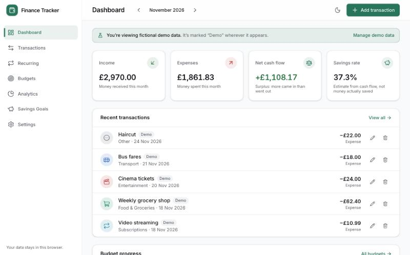
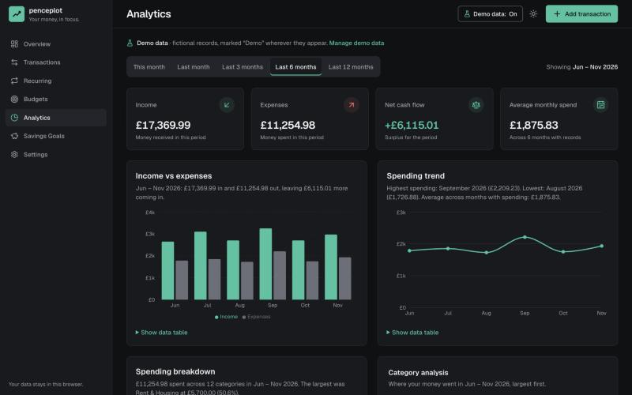
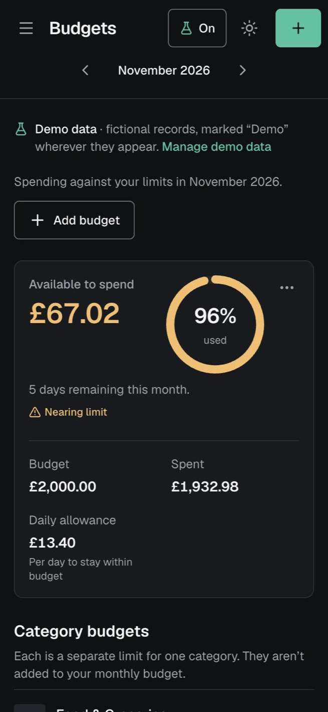

# Finance Tracker

[](https://github.com/Ibz909/Finance-Tracker/actions/workflows/ci.yml)
[](https://github.com/Ibz909/Finance-Tracker/actions/workflows/deploy.yml)

A personal finance tracker for recording income and spending in GBP, setting budgets, saving towards goals and seeing where your money goes. Built with React, TypeScript and Tailwind CSS.

**Everything stays in your browser:** there is no server, no account and no tracking.

### [Try it live →](https://ibz909.github.io/Finance-Tracker/)

Turn on **Demo data** in the top bar to explore with six months of fictional data, then turn it off to start with your own.



<p>
  
  
</p>

<sub>Screenshots show the app's built-in fictional demo data.</sub>

## Features

- **Transactions:** add, edit and delete income and expenses, then search, filter by type, category and date, and sort. Filters are kept in the URL, so a view can be bookmarked.
- **Dashboard:** income, expenses, net cash flow and savings rate for any month, with recent transactions, budget progress, savings goals and charts.
- **Budgets:** one overall monthly limit and one per spending category, each shown as _On track_, _Nearing limit_ or _Over budget_.
- **Analytics:** income vs expenses, a spending trend and a category breakdown for this month, last month, or the last 3, 6 or 12 months. Every chart has a written summary and a table of the exact figures.
- **Recurring transactions:** set up salary, rent or subscriptions once. Each payment is added on its due date, including any that fell due while the app was closed. Schedules can be paused, resumed and edited.
- **Savings goals:** record deposits and withdrawals towards a target, and see how much to save each month to reach it by a date. Saving isn't counted as spending.
- **CSV import and export:** export transactions to open in a spreadsheet or keep as a backup. Imports are checked row by row and previewed before anything is saved, with duplicates skipped.
- **Themes:** light, dark or follow your device, with no flash of the wrong theme on load.
- **Demo data:** the **Demo data** switch in the top bar loads six months of clearly labelled fictional transactions, budgets, recurring payments and savings goals. Turning it off never touches your own records.
- **Safe reset:** delete everything after typing a confirmation word, with an option to export first.
- **Accessible and responsive:** designed to meet WCAG 2.2 AA, with full keyboard support. Works on screens from 320px wide.

## Tech stack

| Area    | Choice                                        | Why                                                                                          |
| ------- | --------------------------------------------- | -------------------------------------------------------------------------------------------- |
| UI      | React 19 + TypeScript (strict)                | Function components and hooks; strict types catch mistakes before they run.                  |
| Build   | Vite 8                                        | Fast dev server and builds; Vitest shares its configuration.                                 |
| Styling | Tailwind CSS v4                               | Design tokens as CSS variables, so light and dark themes swap one set of values.             |
| Routing | React Router 8                                | One layout route; each page's code loads the first time it's visited.                        |
| Forms   | React Hook Form + Zod 4                       | One schema validates forms, stored data and CSV imports, and generates the TypeScript types. |
| Charts  | Recharts                                      | Composable SVG charts, themed with the same tokens and loaded only when a chart is shown.    |
| Dates   | date-fns                                      | Calendar maths in local time, without timezone surprises.                                    |
| Icons   | Lucide React                                  | Consistent, tree-shakeable icons.                                                            |
| Tests   | Vitest, React Testing Library, axe-core       | Tests use the app the way people do, plus automated accessibility checks.                    |
| Quality | ESLint (type-aware), Prettier, GitHub Actions | Every pull request is type-checked, linted, tested and built.                                |

## Getting started

You'll need [Node.js](https://nodejs.org/) 20.19+ or 22.12+ (the repo's `.nvmrc` uses 22) and npm.

```bash
git clone https://github.com/Ibz909/Finance-Tracker.git
cd Finance-Tracker
npm ci
npm run dev
```

Open http://localhost:5173. To explore without typing anything, turn on **Demo data** in the top bar.

### Scripts

| Command                           | What it does                                                         |
| --------------------------------- | -------------------------------------------------------------------- |
| `npm run dev`                     | Starts the development server with hot reload.                       |
| `npm run build`                   | Type-checks, then builds a production bundle into `dist/`.           |
| `npm run preview`                 | Serves the production build locally.                                 |
| `npm test` / `npm run test:watch` | Runs the tests once, or in watch mode.                               |
| `npm run lint` / `npm run format` | Lints with ESLint, or formats with Prettier.                         |
| `npm run check`                   | Runs everything CI runs: types, lint, formatting, tests and a build. |

## How it's built

### Data flow

```text
Component ──► action hook (validates with Zod) ──► dispatch ──► pure reducer
    ▲                                                             │
    │  derived figures (useMemo)                                   ▼
AppData context ◄───────────────── new state ──────────────► DataRepository.save()
                                                               (localStorage today)
```

- **One source of truth.** All data lives in a single provider, and every change goes through a pure, tested reducer.
- **Totals are never stored.** Balances, budget progress and savings are calculated from the records, so they can't drift out of sync.
- **Storage is swappable.** Components never touch `localStorage` directly. They use a `DataRepository` interface, so a server-backed version could replace it without changing the pages.

### Key decisions

- **Money is stored as integer pence** (£12.50 is `1250`). Floating point can't represent most decimals exactly, but whole numbers are always exact. Typed amounts are parsed from their digits, never with `parseFloat`.
- **Dates are calendar strings** (`YYYY-MM-DD`) read in local time. `new Date('2026-03-01')` means UTC midnight, which is a different day in some timezones, so the app never uses it.
- **Stored data is versioned.** Data is saved as `{ schemaVersion, data }`, and older data is upgraded by a chain of tested migrations. Records are validated one by one on load, so one damaged record never loses the rest, and anything unreadable is backed up before being replaced.
- **Recurring dates are counted from the start date,** never from the previous payment. That way a payment on 31 January falls on 28 February and then 31 March, instead of drifting to the 28th.
- **Savings aren't transactions.** Moving money into a goal isn't spending, so it never affects budgets or charts.
- **Imports are safe.** The CSV parser handles quoted commas and line breaks without a dependency. Exports guard against spreadsheet formula injection.
- **Code loads when it's needed.** Each page, and the charting library, is downloaded the first time it's used.
- **Deploys only after the tests pass.** Every merge to `main` runs CI, and only a passing commit is published to GitHub Pages. If a new version goes out while the app is open, it reloads once to pick it up instead of failing.

## Accessibility

The app is designed to meet **WCAG 2.2 AA**.

- **Keyboard:** everything works from the keyboard, with a visible focus outline. Dialogs keep focus inside and return it to the button that opened them.
- **Status in words:** budget and goal statuses are written out, not shown by colour alone. Every chart has a text summary and a data table, and the drawn chart itself is hidden from screen readers.
- **Clear errors:** form errors are linked to their fields. Changes such as "Transaction added" and filter result counts are announced.
- **Reflow:** layouts work at 320px wide and with enlarged text spacing, and the app respects "reduce motion".
- **Automated checks:** axe-core runs on every page and the main dialogs in the test suite. A separate test checks the theme's text and control colours, in both themes, against the WCAG contrast minimums.

## Testing

```bash
npm test
```

There are over 650 tests:

- **Logic:** money parsing, date maths (month ends, leap years and UK clock changes), schemas, the reducer, migrations, budget and goal progress, recurring schedules, and CSV parsing and validation.
- **User journeys:** each page is rendered through the real routes and providers, covering adding, editing and deleting records, validation and focus, filtering, imports, demo data and reset.
- **Accessibility:** axe-core checks and theme contrast tests.

Tests never depend on the real date: "today" is fixed. They run in UK time (`Europe/London`), and date-handling tests use summer dates, when UK time differs from UTC.

## Data and privacy

- Your data is stored only in this browser's `localStorage`. Nothing is sent anywhere: there's no backend, analytics or third-party API.
- Data isn't shared between browsers or devices. Clearing your browser's site data, or using a private window, removes it.
- Use **Settings → Import and export** to keep a CSV backup of your transactions.

## Limitations

- **GBP only,** by design.
- **One browser on one device,** with no accounts or sync.
- **CSV import and export cover transactions only,** not budgets, goals or recurring schedules.
- Possible next steps: optional accounts with sync across devices, and a full backup and restore covering all data.
